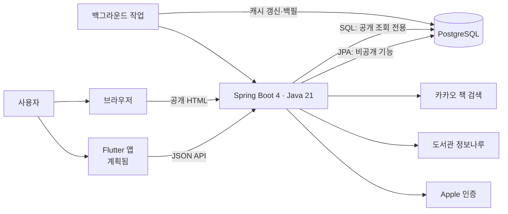
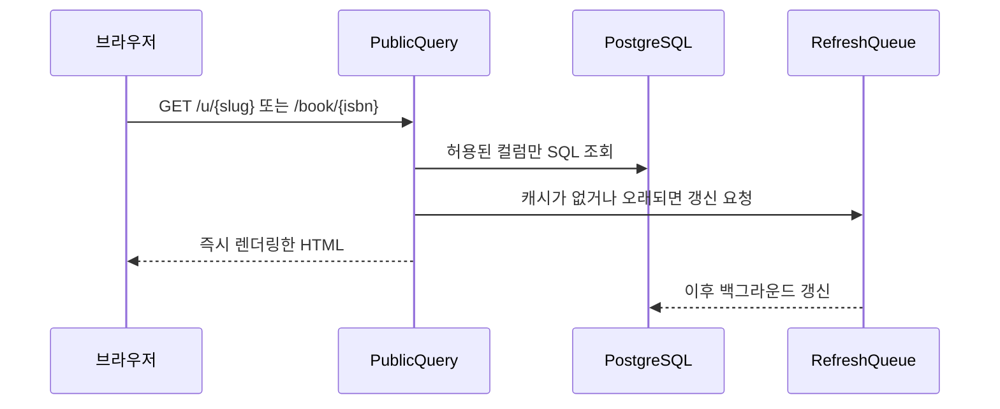
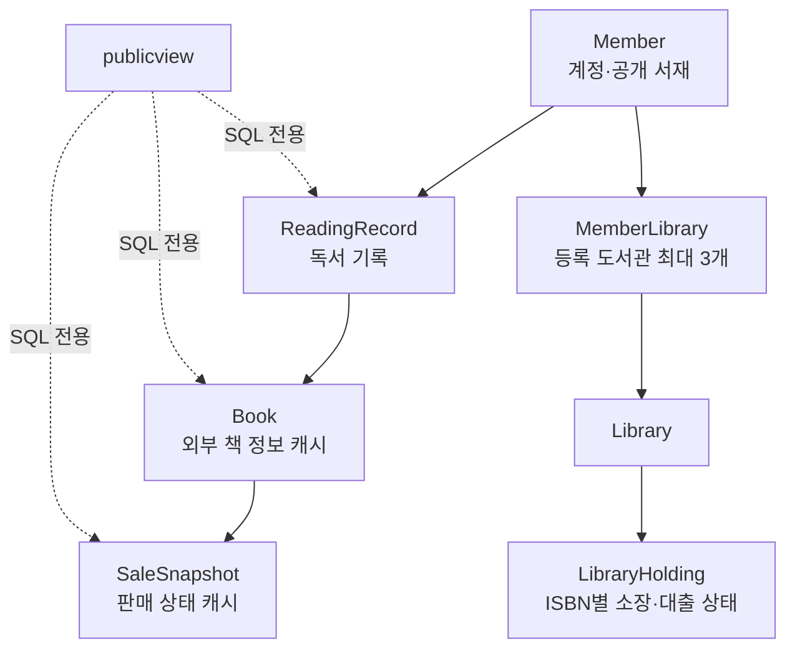

# book-shelf

바코드를 찍어 책을 기록하고, 빌리거나 구매할 수 있는 경로를 한 화면에서 보는 개인 서재 서비스입니다.

현재는 Spring Boot 서버와 공개 웹을 구현한 상태입니다. Flutter 앱은 다음 단계에서 같은 저장소의 `app/`에 추가할 계획입니다.

## 구조 한눈에 보기



공개 웹 요청은 외부 제공자를 기다리지 않습니다. 캐시된 데이터만 즉시 보여 주고, 오래됐거나 없는 데이터의 갱신은 큐와 백그라운드 작업으로 넘깁니다.



## 기능 영역

| 영역 | 담당 패키지 | 내용 |
| --- | --- | --- |
| 인증 | `auth` | Apple 로그인, JWT 갱신·로그아웃, 계정 삭제, 로컬 개발 로그인 |
| 회원·기록 | `member`, `record` | 공개 서재 설정, 독서 상태·별점·한줄평·공개 범위 |
| 책·판매 상태 | `book`, `catalog.kakao` | ISBN으로 책을 찾고 판매 상태를 캐시 |
| 검색 | `search` | 제목 검색과 검색 결과 캐시 |
| 도서관 | `library` | 지역별 도서관 탐색, 최대 3개 등록, 소장·대출 가능 여부 |
| 공개 웹 | `publicview` | `/u/{slug}`, `/book/{isbn}`, SEO용 robots·sitemap |
| 외부 호출 정책 | `provider` | 제공자별 일일 예산, 사용자 호출 한도, 쿨다운 |
| 공통 | `common`, `links`, `ops` | 오류 응답, 시간, 서점 링크, 예약 작업 |

## 데이터와 경계



`publicview`는 JPA 엔티티·리포지터리·서비스를 재사용하지 않습니다. 공개 URL에는 회원 ID 대신 slug만 사용하며, 비공개·없는·탈퇴한 서재는 모두 같은 404를 반환합니다. 이 규칙은 `PublicViewArchitectureTest`로 검증합니다.

## 디렉터리 안내

```text
src/main/java/com/bookshelf/
├── auth/                 인증과 보안
├── book/                 책, 판매 상태, 갱신 큐
├── catalog/kakao/        카카오 책 검색 클라이언트
├── library/              도서관과 정보나루 연동
├── member/ · record/     회원과 독서 기록
├── publicview/           로그인 없는 SSR 공개 페이지
├── provider/             외부 API 예산·쿨다운
├── search/               제목 검색과 캐시
└── common/ · links/ · ops/

src/main/resources/
├── db/migration/         Flyway 스키마 마이그레이션
├── templates/public/     Thymeleaf 공개 페이지
├── static/css/           공개 페이지 스타일
└── application.yaml      환경 변수 기반 설정

src/test/                 통합·도메인·아키텍처 테스트
deploy/                   OCI/Nginx/Docker 배포 구성과 운영 절차
docs/                     제품 설계, 구현 계획, 제공자 조사 기록
```

## 로컬 실행

Java 21과 Docker가 필요합니다.

```bash
docker compose up -d
set -a && . ./.env && set +a && ./gradlew bootRun
```

로컬에서는 Apple 로그인 없이 개발 로그인을 활성화할 수 있습니다. 백그라운드 작업도 함께 끌 수 있습니다.

```bash
set -a && . ./.env && set +a && \
  DEV_LOGIN_ENABLED=true BACKGROUND_JOBS_ENABLED=false ./gradlew bootRun
```

테스트는 별도의 `bookshelf_test` 데이터베이스를 사용합니다.

```bash
./gradlew test
```

필요한 환경 변수와 배포 절차는 [deploy/README.md](deploy/README.md)를 참고하세요. `.env`와 실제 키·토큰은 절대 커밋하지 않습니다.

## 개발 규칙

- 스키마 변경은 새 Flyway 마이그레이션으로만 합니다. 배포된 `V` 파일은 수정하지 않습니다.
- 외부 API 호출은 제공자별 클라이언트 한 곳에서만 수행하며, 트랜잭션 안에서는 호출하지 않습니다.
- 시간은 `Instant`와 `Clock` 빈을 사용합니다.
- 엔티티에는 `@Setter`, `@Data`, `@ToString`을 사용하지 않고 정적 팩토리로 생성합니다.
- 사용자 입력은 Thymeleaf `th:text`로 출력합니다.

상세한 제품 의도, 설계 근거, 구현 상태는 [docs/README.md](docs/README.md)에서 확인할 수 있습니다.
